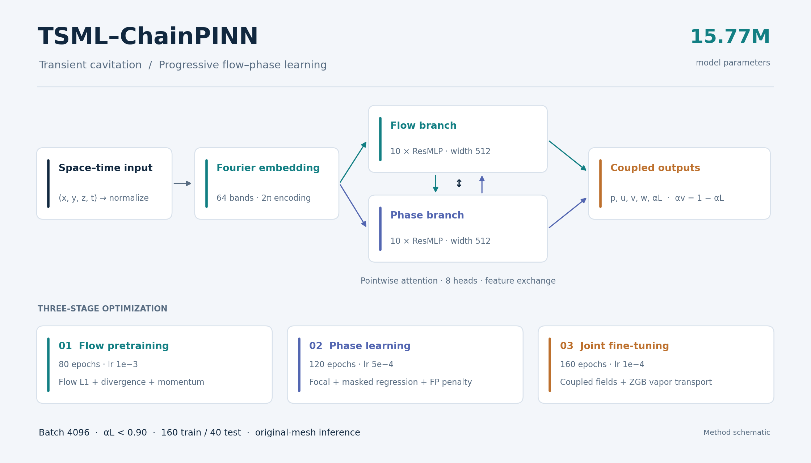
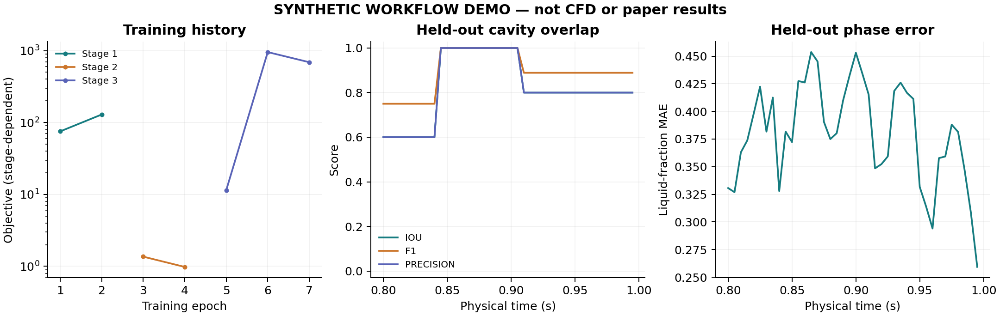

<div align="center">

# TSML-ChainPINN

### Three-stage physics-informed learning for transient cavitation

**Fourier features · Coupled flow/phase branches · ZGB transport · Original-mesh inference**

[Quick start](#quick-start) · [中文](README_zh-CN.md) · [Method](docs/METHOD.md) · [Data](docs/DATA.md) · [Reproducibility](docs/REPRODUCIBILITY.md)



</div>

A self-contained PyTorch research implementation accompanying the **2026-10-18 manuscript revision** of *Transient cavitation reconstruction in hydrodynamic torque converter stators via physically constrained flow and phase learning*.

The model reconstructs velocity, pressure, and liquid volume fraction from space–time coordinates for a prescribed operating condition. Flow and phase representations are learned progressively, then coupled through joint physics-informed optimization.

## What is included

| Component | What you can do |
|---|---|
| Full paper architecture | 10-block, 512-wide flow and phase branches; 64 Fourier bands; 8 attention heads; **15,766,021 parameters** |
| Three-stage optimization | Train flow, phase, then joint fields with a phase-only warm-up |
| Physical regularization | Differentiate dimensional fields for divergence, conservative mixture momentum, and ZGB vapor transport |
| Reproducible workflows | Chronological partitions, fitting-only statistics, seed records, epoch checkpoints |
| Practical inference | Evaluate original meshes or query physical coordinates through Python |
| Experiment tools | Independent seeds, mean/sample SD aggregation, and plots from recorded logs |
| Runnable example | A complete synthetic train → evaluate → plot workflow without CFD files |
| Repository essentials | Tests, CI workflow, configuration, documentation, citation metadata, MIT license |

**Release scope.** This is a revised implementation, not a redistribution of the original training artifacts. CFD datasets and paper-version trained weights are not bundled. Legacy weights are incompatible. The synthetic demo demonstrates software operation, not paper accuracy. See [reproduction status](docs/REPRODUCIBILITY.md).

## Quick start

From the repository root:

```bash
python -m pip install -e ".[viz]"
tsml doctor
tsml demo --output outputs/demo --plot
```

The demo creates 200 small, explicitly synthetic snapshots, trains a reduced model through all three stages, evaluates the last 40 snapshots, and saves:

```text
outputs/demo/
├── data/                 # synthetic data + separate reduced configuration
├── run/                  # checkpoints, history, normalization, provenance
├── evaluation/           # per-snapshot metrics and aligned predictions
└── figures/              # PNG/SVG generated from the recorded run
```

The demo does **not** modify `configs/paper.json`. Use a new output directory when running again.



## Train with the paper configuration

Supply the actual 200-snapshot CFD sequence and explicit field/unit mappings. The adapter retains original mesh coordinates rather than resampling onto a uniform grid.

```bash
python -m pip install -e ".[vtk]"
tsml prepare --source-manifest source_manifest.json --output data/prepared
tsml inspect-data --manifest data/prepared/manifest.json --verify-hashes
tsml check --config configs/paper.json
tsml train --config configs/paper.json --manifest data/prepared/manifest.json --output runs/c1_seed1337 --mode final --seed 1337 --device cuda
tsml evaluate --checkpoint runs/c1_seed1337/stage3.pt --manifest data/prepared/manifest.json --output results/c1_seed1337 --device cuda --save-predictions
```

See [data preparation](docs/DATA.md) and [training details](docs/TRAINING.md).

### Continue an interrupted run

Repeat the identical training command with `--resume`. `latest.pt` restores the last completed epoch, optimizer state, and random-number generators. Output directory, configuration, mode, seed, and data manifest must match.

### Three independent seeds

```bash
tsml experiment --config configs/paper.json --manifest data/prepared/manifest.json --output experiments/c1 --mode final --seeds 1337 2024 3407 --device cuda
```

Each model starts from initialization. Evaluation produces a Markdown/CSV/JSON aggregate. These seed integers are documented software defaults; the manuscript does not identify its original seed integers. Train each operating condition separately.

## Python library

```python
import numpy as np
from tsml_chainpinn.inference import Surrogate

surrogate = Surrogate("runs/c1_seed1337/stage3.pt", device="cuda")
xyzt = np.load("query_xyzt.npy")  # (N,4): x,y,z in metres, t in seconds
prediction = surrogate.predict(xyzt, batch_size=4096)
pressure_velocity = prediction["flow"]  # [p_abs,u,v,w], Pa and m/s
alpha_liquid = prediction["alpha_liquid"]
alpha_vapor = prediction["alpha_vapor"]
```

Inspect the untrained architecture using `python examples/model_forward.py`. File-to-file inference: [examples/predict_points.py](examples/predict_points.py).

## Paper defaults

| Setting | Value |
|---|---|
| Branch depth / width | 10 / 512, both branches |
| Fourier bands / attention | 64 bands, 2⁰–2⁸, with 2π / 8 heads |
| Optimizer / effective batch | Adam / **4096** |
| Stage epochs | 80 / 120 / 160 |
| Learning rates | 1×10⁻³ / 5×10⁻⁴ / 1×10⁻⁴ |
| Stage-3 warm-up | First 20 epochs, phase branch only |
| Hybrid coefficients / focal gamma | 1.0, 0.5, 2.0 / 2.0 |
| Stage-3 phase weight | 14.0 |
| Cavitation mask / enrichment | alpha_L < 0.90 / 20% cavitation pool + 80% full domain |
| Stage-1 physics coefficients | divergence 0.10; momentum 0.05 |
| Stage-3 physics coefficients | divergence 0.05; momentum 0.05; vapor 0.10 |
| Selection / final split | 128 fitting + 32 validation / 160 training + 40 test |

Batch 4096 follows Table S1 and the author's resolution of the 640-point manuscript conflict. Memory microbatches preserve the full-batch objective. [Paper alignment](docs/PAPER_ALIGNMENT.md) distinguishes specified values from implementation choices and editable material defaults.

## Repository map

```text
src/tsml_chainpinn/
  model.py            Fourier embedding, residual branches, attention
  physics.py          Dimensional derivatives, mixture momentum, ZGB
  losses.py           Mask-guided hybrid supervision
  data.py             Splits, normalization, sampling
  prepare.py          Optional original-mesh VTK adapter
  engine.py           Training and held-out evaluation
  checkpoint.py       Atomic checkpoints and RNG restoration
  inference.py        Coordinate-to-field Python API
  experiments.py      Independent-seed runs and aggregation
  demo.py             Synthetic end-to-end example
  reporting.py        Saved-log and metric plots
  diagnostics.py      Environment/data validation
  cli.py              Command-line interface
configs/              Paper settings and manifest example
examples/             Python examples
tests/                Analytic physics and workflow tests
docs/                 Method, data, training, API, reproducibility
.github/              Automated checks and contribution templates
```

## Tests

```bash
python -m pip install -e ".[all]"
python -m pytest -q
```

Tests cover chain rules, conservative momentum, ZGB source signs, masks, freezing, batch equivalence, split leakage, mesh conversion, resume equivalence, and inference. [Local validation](docs/VALIDATION.md) records executed checks. GitHub Actions configuration is supplied; remote CI has not run until the repository is hosted.

## Citation and contribution

Use [CITATION.cff](CITATION.cff) for this release. The associated manuscript is identified by title and revision; no DOI or publication status is invented. Bug reports should include `tsml doctor`, the command, configuration, and a small reproducer. See [CONTRIBUTING.md](CONTRIBUTING.md).

**License:** [MIT](LICENSE), covering this code. CFD data and publication figures are not included in this repository's license grant.
